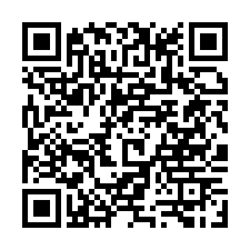

Récepteur et émetteur BLU QO-100 bande étroite pour carte Tezuka (FishBall 7020, Pluto) et téléphone Android.

## Nouveautés de la v1.1

- **Installation de la carte depuis l'appli** : plus rien à copier à la main, un bouton suffit (voir plus bas).
- **START / STOP** en bas de l'accueil, à côté du PTT. STOP rend la radio de la carte : SDR Console (ou un autre logiciel) peut alors s'en servir. START la reprend.
- **Verrouillage balise plus fiable** au démarrage : il ne se cale plus sur le reflet de la balise, et reprend sa recherche après 15 s s'il la perd.

## Ce qu'il faut

- Une carte avec le firmware **Tezuka** (broker MQTT inclus), reliée au LNB et, pour émettre, au PA.
- Un téléphone **Android 8 ou plus récent** sur le même réseau que la carte.
- Facultatif : l'Arduino de commutation PTT (le même qu'avec Android-DATV).

Le firmware de la carte n'est pas modifié. L'application installe elle-même ce qu'il faut sur la carte SD : il n'y a rien à copier depuis un PC.

## Installer

1. Sur le téléphone, ouvrir ce lien, qui donne toujours la dernière version :
   **https://github.com/F4HSL-Yves/Android-NB/releases/latest/download/qo100-nb.apk**
   ou scanner ce QR code :

   

   Si Chrome prévient que le fichier peut être dangereux, choisir « Télécharger quand même ». Ouvrir ensuite le fichier téléchargé. La première fois, Android demande d'autoriser l'installation depuis Chrome : « Paramètres », activer « Autoriser cette source », revenir et toucher « Installer ». Si Play Protect avertit d'une appli inconnue, choisir « Installer quand même ».
2. Ouvrir l'onglet **Réglages réception** et saisir l'adresse de la carte.
3. Dans **Installer sur la carte**, saisir le mot de passe root de la carte (`analog` par défaut sur Tezuka), puis appuyer sur **Installer / mettre à jour**.

L'appli copie le programme et ses scripts dans `/boot/nb` sur la carte SD, puis ajoute le lancement au démarrage. La bande étroite démarre aussitôt, puis à chaque mise sous tension. Un démarrage DATV (Webtioune, Android-DATV) reprend la radio automatiquement, puis la rend à la bande étroite quand il s'arrête. Pour SDR Console, qui ne prévient pas la carte, appuyer d'abord sur **STOP**.

4. Appuyer sur **START** en bas de l'accueil.
5. Pour émettre, dans **Réglages émission** :
   - indiquer si un Arduino commande le PTT ;
   - lancer **Calibrer** une fois pour régler la correction TX (émet une porteuse quelques secondes).
   Le gain TX se règle sur l'accueil.

Les réglages de la carte sont dans `/boot/nb/nb.conf`, que les mises à jour ne remplacent pas :
- retirer `--tx` pour une carte en réception seule ;
- retirer `--beacon 10489750000` pour se caler sur la balise CW à 10489,500 au lieu de la balise PSK centrale (celle qu'utilise SDR Console).

Sans l'appli, le zip `qo100-nb-carte-….zip` contient les mêmes fichiers : copier son dossier `nb` dans la partition `boot` de la carte SD, puis lancer une fois `sh /boot/nb/install.sh` par ssh.

## Mettre à jour

Installer le nouvel APK par-dessus l'ancien, puis appuyer de nouveau sur **Installer / mettre à jour** : la carte reçoit la nouvelle version, et ses réglages sont conservés.
